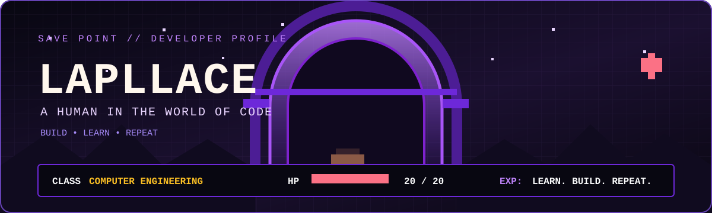

<!-- PROFILE README — Lapllace | Undertale-inspired RPG / pixel art -->

  
   
  
  
  

---

## ♥ NEW GAME — SOBRE MIM

Oi! Sou **Alison Barbosa**, estudante de **Engenharia da Computação na UFRB** e desenvolvedor em formação.

Gosto de transformar ideias em ferramentas reais: aplicações desktop, sistemas web, automações e soluções para pesquisa. Também tenho interesse em visão computacional, processamento de imagens e experiências digitais com personalidade.

- 🎓 Engenharia da Computação — Universidade Federal do Recôncavo da Bahia.
- ⚡ Construindo aplicações e integrações entre diferentes serviços.
- 🧪 Explorando programação aplicada à pesquisa e análise de dados.
- 🎮 Curto jogos, pixel art, interfaces dark e projetos criativos.

## ⚔️ INVENTORY — TECNOLOGIAS

  

  
  
  
  
  
  
  

## 🗂️ SAVE FILES — PROJETOS EM DESTAQUE

| Projeto | Missão |
|---|---|
| [♟️ ChessStream](https://github.com/Lapllace/ChessStream) | Aplicativo desktop para streamers de xadrez, com chats de lives integrados e fila de desafios para o Chess.com. |
| [🧪 Antocianinas Lab](https://github.com/Lapllace/Antocianinas-Lab) | Ferramentas para organizar, modelar e analisar dados de pesquisa sobre estabilidade de antocianinas. |
| [🧘 Reiki](https://github.com/Lapllace/Reiki) | Sistema para organizar disponibilidades e inscrições em sessões de Reiki na UFRB. |
| [🛒 Loja](https://github.com/Lapllace/Loja) | Projeto de e-commerce com catálogo, pagamentos e integrações de entrega. |
| [🤖 ARC Raiders Bot](https://github.com/Lapllace/ARC_Raiders_Bot) | Projeto de automação relacionado ao jogo ARC Raiders. |

## 📊 STATUS — SAVE DATA

  
  

  

  

## 📡 CONTACT — ENCONTRE-ME

  
  
  

---

  <h3>♥ DON'T GIVE UP.</h3>
  Every bug is an encounter. Every commit is a save point.
   
  <i>Determinação é o que move o próximo passo.</i>

